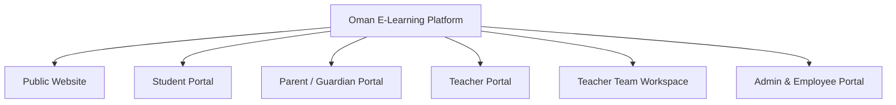
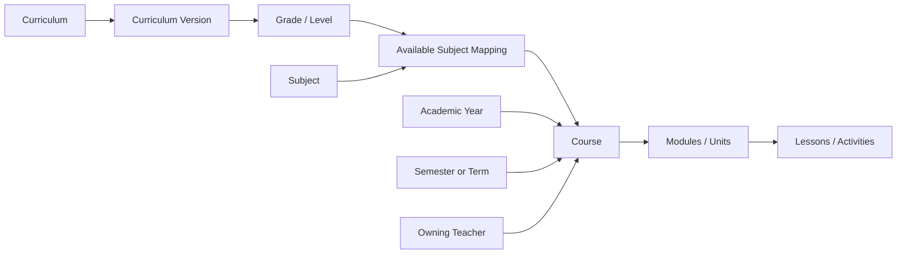
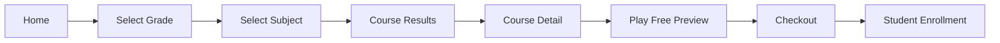

# Information Architecture — Oman School E-Learning Platform

**Version:** 1.0 · **Date:** 19 October 2026  
**Purpose:** Website sitemap, navigation model, content taxonomy, role-specific workspaces and principal user journeys.  
**Status labels:** **Confirmed** = business-owner decision; **Recommended** = design proposal; **Open** = requires approval.

## 1. IA principles

1. **Grade-first discovery:** The fastest route for a family is curriculum → grade → subject → available courses.
2. **Many teachers, one academic catalog:** A subject/grade can contain courses from multiple teachers; each course has one accountable owner at launch.
3. **Separate identities and workspaces:** Students, guardians, teachers, teacher assistants and admin employees use purpose-built navigation with scoped actions.
4. **Purchase != learner:** A parent may pay for a child; an order, an access grant and a course enrollment are distinct.
5. **Public preview != enrollment:** Unenrolled visitors may watch designated preview lessons, not other course material.
6. **Not every grade offers every subject:** The academic taxonomy is managed centrally by curriculum and school period.
7. **Arabic-first navigation:** Human-friendly localized labels, RTL layouts and clear grade labels. Store stable machine IDs independent of translations.
8. **Progressive complexity:** Show student-facing simplicity; keep moderation, finance and organization tools in restricted workspaces.

## 2. Top-level product surfaces



A user may hold multiple authorized capacities, e.g., a teacher who is also a parent. The application should allow explicit **workspace switching**, not indiscriminate merging of privileges.

## 3. Complete website sitemap

```text
ROOT /
├── Home
│   ├── Grade selector
│   ├── Curriculum selector (shown when >1 active curriculum)
│   ├── Featured subjects/courses
│   ├── Featured teachers
│   └── How it works / CTA
├── Explore Courses
│   ├── Browse by Grade
│   │   └── Grade Landing Page
│   │       └── Subjects Available for Grade
│   │           └── Subject Course Results
│   ├── Browse by Subject
│   ├── Browse by Teacher
│   ├── Search Results / Filters
│   └── Course Detail
│       ├── Overview / Teacher
│       ├── Learning Outcomes
│       ├── Syllabus and Modules
│       ├── Free Video Previews
│       ├── Live/Recorded Format
│       ├── Pricing / Access Duration
│       ├── Reviews (if enabled)
│       └── Buy / Enroll
├── Teachers Directory
│   └── Teacher Public Profile
│       └── Teacher Courses
├── Become a Teacher / Application
├── About
├── Help Center / Contact
├── Privacy / Terms / Refund Policy
├── Authentication
│   ├── Sign In / Reset Password
│   ├── Student Registration
│   ├── Parent / Guardian Registration
│   └── Teacher Registration / Application
└── Checkout
    ├── Sign in / Create Account
    ├── Select Beneficiary Student
    ├── Order Review
    ├── Provider Payment
    ├── Success / Pending / Failure
    └── Receipt / Enrollment Access

STUDENT PORTAL
├── Home / Dashboard
├── My Courses
│   └── Learning Room
│       ├── Overview / Progress
│       ├── Modules and Lessons
│       ├── Video / Reading Player
│       ├── Attachments and Worksheets
│       ├── Quizzes / Assignments
│       ├── Live Sessions / Recordings
│       ├── Course Q&A
│       └── Course Announcements
├── Browse Courses
├── Calendar and Live Classes
├── Assignments / Quiz Results
├── Messages / Questions
├── Notifications
├── Learning Profile
└── Account / Privacy

PARENT / GUARDIAN PORTAL
├── Dashboard (children summary)
├── My Children
│   ├── Link / Verify Child
│   └── Child Dashboard
│       ├── Courses / Progress
│       ├── Assignments / Results
│       ├── Upcoming Live Sessions
│       └── Attendance / Learning Activity
├── Explore / Buy for a Child
├── Orders / Receipts
├── Notifications
├── Support
└── Guardian Settings / Link Permissions

TEACHER PORTAL
├── Dashboard (courses, students, inbox, earnings)
├── My Courses
│   ├── Create / Edit Course
│   └── Course Workspace
│       ├── Details / Publishing
│       ├── Modules / Lessons / Previews
│       ├── Resources / Assessments
│       ├── Live Sessions / Recordings
│       ├── Enrollments / Learner Progress
│       ├── Questions / Announcements
│       └── Course Analytics
├── Students (scoped to owned courses)
├── Inbox / Q&A
├── Teaching Calendar
├── Team Management
│   ├── Invite Members
│   ├── Assign Course Access
│   └── Manage Member Permissions
├── Earnings
│   ├── Sales & Commissions
│   ├── Pending / Available Payables
│   ├── Payout History
│   └── Payout Destination
├── Notifications
└── Teacher Public Profile / Settings

TEACHER TEAM WORKSPACE
├── Assigned Work Overview
├── Assigned Courses
├── Inbox
│   ├── Open / Assigned / Escalated / Resolved
│   └── Conversation Details and Internal Notes
├── Lesson Q&A
├── Assigned Grading / Content Tasks (if permitted)
├── Notifications
└── Personal Settings

ADMIN / EMPLOYEE PORTAL
├── Operational Dashboard
├── Accounts & People
│   ├── Students
│   ├── Guardian Links
│   ├── Teachers / Applications / Invitations
│   ├── Admin Employees
│   └── Teacher Teams (oversight, restricted)
├── Academic Catalog
│   ├── Curricula / Versions / Tracks
│   ├── Grade Levels / Stage Labels
│   ├── Subjects / Grade-Subject Mappings
│   ├── Academic Years / Semesters
│   └── Subject Display Labels / Translation
├── Course Operations
│   ├── Pending Approval
│   ├── Published / Draft / Archived
│   ├── Content Reports / Takedowns
│   ├── Enrollments / Entitlements
│   └── Live Session Oversight
├── Commerce & Finance [restricted]
│   ├── Orders / Provider Transactions
│   ├── Refunds / Disputes / Chargebacks
│   ├── Commission Rules / Overrides
│   ├── Teacher Earnings / Ledgers
│   ├── Payout Accounts / Batches / Approvals
│   ├── Reconciliation / Financial Reports
│   └── Tax / Invoice Configuration
├── Support & Safety
│   ├── Tickets / Flags / Moderation
│   └── Communication Reports / Escalations
├── CMS & Marketing
│   ├── Homepage / Banners
│   ├── Static Pages / FAQs
│   └── Optional Coupons / Promotions
├── Notification Templates / Delivery
├── Analytics & Reports
└── Administration
    ├── Roles / Permissions / Scope
    ├── Security / Audit Log
    ├── Integrations
    └── Platform Policies
```

**Note:** Admin employees should only see modules permitted to their role/scope. The sitemap does not imply universal access.

## 4. Primary navigation by audience

| Audience | Primary sidebar / navigation | Priority action |
|---|---|---|
| Visitor | Home, Explore, Teachers, Become a Teacher, Help | Choose grade and preview a course |
| Student | Dashboard, My Courses, Calendar, Assignments, Messages, Notifications | Continue learning |
| Guardian | Dashboard, My Children, Explore, Orders, Notifications | Select child / review progress |
| Teacher | Dashboard, My Courses, Inbox, Live Calendar, My Team, Earnings | Publish/manage a course |
| Assistant | Assigned Courses, Inbox, Q&A, Tasks | Resolve assigned student needs |
| Admin employee | Only assigned admin modules | Work through relevant approval/task queue |
| Owner/Super Admin | Platform overview plus controlled administration | Review operations, risk, finances |

## 5. Academic information model



### Taxonomy objects

- **Curriculum:** e.g., Oman Ministry curriculum at launch. Future curricula can be configured.
- **Curriculum version:** A publication/revision of academic content; avoid retroactively changing existing courses.
- **Stage label:** Optional grouping; Oman references basic education cycles (1–4, 5–10), and post-basic 11–12. Other organizational groupings exist; don't equate these mechanically.
- **Grade/level:** Grade 1–12 for Oman at launch; alternative curricula may have different labels.
- **Subject:** Canonical and localized titles; grade availability specified through mappings.
- **Academic year, semester/term:** Course context and display filtering; not necessarily exclusive enrollment windows.
- **Track/pathway (optional):** Important for upper levels where offerings differ.
- **Course:** Specific teacher's offering for a defined academic context; usually one grade and one subject. Cross-grade programs, if required later, need explicit modeling rather than silent duplication.
- **Module/unit → lesson → resource/activity:** Reusable hierarchical course structure.

**Key rule:** Teachers select curriculum/grade/subject from Admin-controlled catalogs. They should not enter arbitrary category strings used for filtering.

## 6. Discovery and purchase flows

### A. Grade-first discovery



At course results allow filters for teacher, course format (live/recorded/hybrid), semester, language, price, and future curriculum where applicable. Do not imply that every filter has meaningful data at launch.

### B. Alternative teacher-first discovery

`Teachers Directory → Teacher Profile → Grade/Subject Filter → Teacher Course → Preview → Checkout`.

### C. Parent purchases for student

`Parent account → Select verified linked student → Course checkout → Payment verified → Course access for selected child → Parent receipt/progress visibility`.

If the user has multiple linked children, beneficiary selection must be explicit; a course purchase should not be accidentally assigned to the parent's own account.

### D. Student learns

`Student dashboard → My Courses → Course room → Module → Lesson → Activity / Quiz → Progress update → Parent summary (if authorized)`.

### E. Teacher applies and publishes

`Teacher registration → Application → Admin verification/approval → Teacher dashboard → Course draft → Content & preview → Publish request → Admin review → Public listing`.

### F. Live-session notification

`Teacher schedules live session → Platform selects enrolled/eligible students → In-app/email event → Student joins → Attendance recorded → Teacher publishes recording → Eligible-student notification`.

### G. Course Q&A support

`Student submits question → Course inbox → Assigned assistant / teacher → Reply or escalation → Resolved → Audit trail`.

## 7. Course detail page content hierarchy

1. **Hero:** title, teacher, curriculum/grade/subject, format, language, price, enrollment CTA.
2. **Trust and value:** learning objectives, prerequisites, intended learner, outcomes, teacher credentials (only verified claims).
3. **Preview player:** explicitly labeled sample lesson, accessible without full paid entitlement.
4. **Curriculum outline:** modules and lessons; distinguish preview from locked lessons.
5. **Scheduling:** upcoming live sessions or course-specific live-session policy; avoid promising fixed dates when none exist.
6. **Access terms:** duration, recordings, support availability, what purchase includes, refund-policy link.
7. **Teacher profile and courses:** helps browsing by teacher.
8. **Reviews/FAQ:** if reviews are enabled and moderation policy exists.

## 8. Course room structure

Use a **single learning room** with tabs/sections rather than separate unrelated page layouts for every resource:

- Left/right contextual module navigator (direction follows locale).
- Main content player/content panel.
- Progress indicator and next/previous lesson.
- Lesson-specific resources.
- Lesson Q&A and teacher announcements.
- Upcoming live class and recording indicators.
- Quizzes/assignments as activity types with completion states.

Lesson completion should be defined by activity type (manual marking, video completion threshold, quiz submitted, etc.) rather than falsely treating a page visit as mastery.

## 9. Content & access visibility matrix

| Resource | Visitor | Enrolled student | Linked guardian | Teacher owner | Assigned assistant |
|---|---|---|---|---|---|
| Published course details | Yes | Yes | Yes | Yes | Yes |
| Designated preview video | Yes | Yes | Yes | Yes | Yes |
| Paid lesson / recording | No | Authorized access | No by default* | Yes | Only if assigned |
| Student quiz/submission | No | Own | Approved summaries/detail only | Own-course learners | With grading permission |
| Course-private messages | No | Own conversations | Policy-controlled | Own-course scope | Assigned conversations only |
| Teacher finances | No | No | No | Own figures | No by default |

*Guardian access to learning content is a separate product decision; monitoring does not require silently sharing student credentials.

## 10. Search, filters, URLs and SEO recommendations

### Search/filter attributes

`curriculum`, `grade`, `subject`, `semester`, `academic_year`, `teacher`, `language`, `delivery_mode`, `price_type`, `price_range`, `availability`.

### Proposed URL patterns (illustrative, not fixed API contracts)

```text
/
/courses
/grades/6
/grades/6/subjects/mathematics
/courses/{course-slug}
/teachers/{teacher-slug}
/become-a-teacher
/checkout/{checkout-id}
/student/dashboard
/student/courses/{course-id}/learn
/parent/children/{child-id}/progress
/teacher/courses/{course-id}/edit
/teacher/team
/admin/teachers/applications
/admin/finance/payouts
```

Prefer stable identifiers with localized slugs where practical. Do not expose private course material or student record URLs to unauthenticated visitors. Public course pages should have meaningful titles and metadata in Arabic and supported languages.

## 11. Empty, error, and edge states to design

- No courses available for a grade/subject; offer alternative teachers or notification, not a dead end.
- Teacher application pending or rejected with permitted feedback.
- Course preview works; locked lesson requires purchase.
- Payment pending, rejected, duplicated callback, or successful after the customer closes the browser.
- Guardian with zero linked children, multiple children or an unverified link.
- Student has no enrollments, expired access or a refunded enrollment.
- Live session cancelled, rescheduled, provider unavailable or recording unpublished.
- Assistant removed from a team while viewing an assigned inbox.
- Course archived after enrollment: define existing-student access policy rather than silently deleting content.
- Expired course, academic year transition, and paused teacher account.

## 12. Accessibility, localization and responsive IA

- Arabic RTL is first-class, not a translation added after layout is complete.
- Clear labels for younger users; larger touch targets and easy navigation for Grades 1–4.
- Accessible forms, keyboard navigation, captions/transcripts where available, readable contrast and descriptive statuses.
- Time display localized for Oman; store timestamps in unambiguous server formats.
- Currency display OMR with correct precision; preserve exact amounts in finance records.
- Student experience optimized for phones; course editor, moderation and finance workflows designed for desktop but remain responsive.

## 13. Governance and sources

Academics and permissions are centrally governed. Teachers cannot create arbitrary official grade or subject categories; administrators maintain academic mappings. Employees and assistants see only their authorized workspaces.

Official context:
- Oman MOE basic education structure: https://moe.gov.om/portal/sitebuilder/sites/eps/English/MOE/BasicEducation.aspx
- Oman MOE discussion of school grade organization: https://home.moe.gov.om/en/topics/0/show/2157?GetLang=en

**Content provenance:** This IA is derived from confirmed stakeholder decisions and recommendations. The original YouTube reference videos were not independently transcribed/verified.

### Related documents
- [Executive Information](01_Executive_Information.md)
- [Executive Summary](02_Executive_Summary.md)
- [Product & Technical Blueprint](04_Platform_Blueprint.md)
