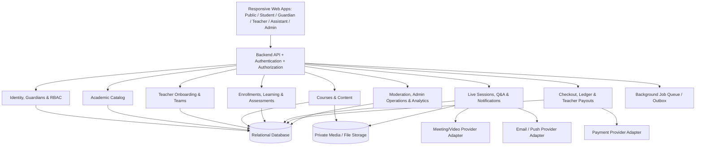
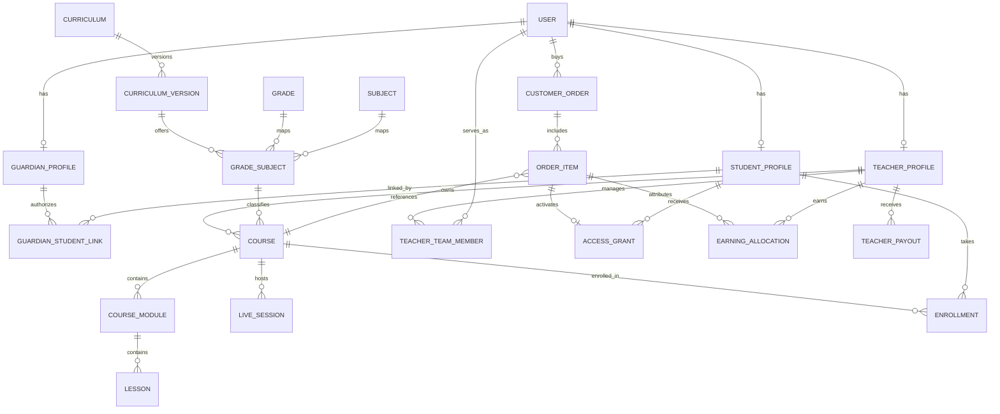
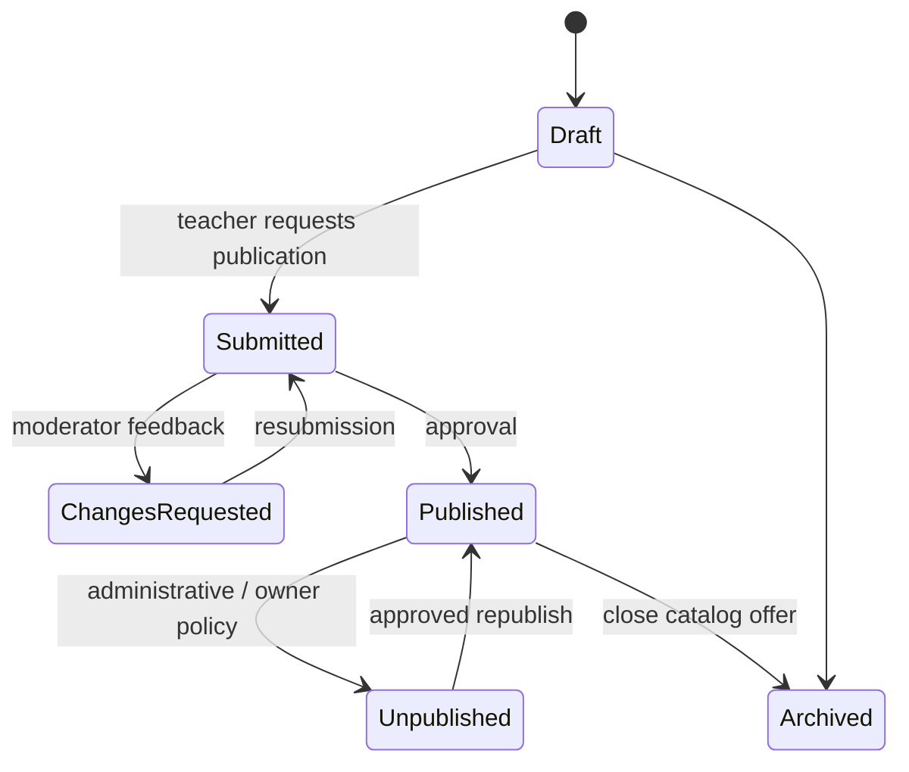
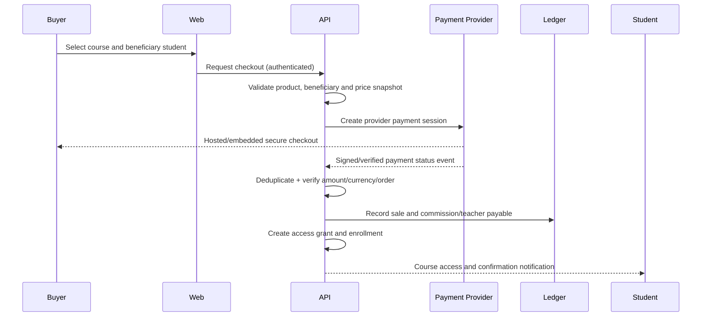
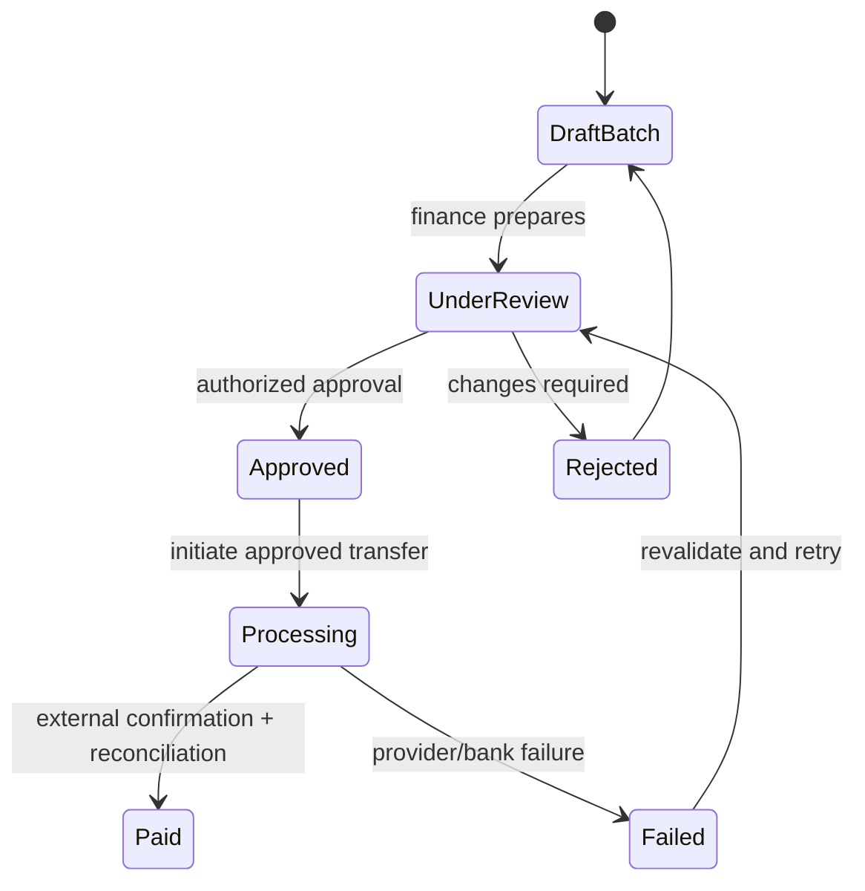

# Product & Technical Blueprint — Oman School E-Learning Platform

**Version:** 1.0 · **Date:** 19 October 2026  
**Classification:** Working solution architecture and functional specification  
**Audience:** Product owner, UX/UI, backend, frontend, QA, security, operations and finance  
**Status:** Recommended design based on confirmed business requirements; not yet a signed implementation contract.

> **Key design outcome:** A managed K–12 education marketplace for Oman, with teacher-owned paid/free courses, preview videos, recorded/live instruction, parent progress monitoring, course-scoped teacher assistants, delegated platform administration, centralized payments, commissions and controlled teacher payouts.

## 1. Requirements taxonomy

Use the following labels throughout implementation:

- **[CONFIRMED]** Explicitly specified by the project stakeholder.
- **[PROPOSED]** Recommended architecture/UX implementation; needs normal product acceptance.
- **[OPEN]** Commercial, technical or regulatory choice not settled yet.

### 1.1 Confirmed product invariants

- One teacher **owns** each course at launch; assistants may act under delegated permissions.
- A teacher may teach any permitted subset of Grades 1–12 and one or many subjects.
- Courses are classified by grade and subject and created by teachers.
- Courses may be free or paid; a paid course may expose a **free sample video** while the rest remains protected.
- Initially, customers buy **individual courses**, not subscriptions; support future subscription entitlements without replacing course models.
- Courses may include recorded lessons and live sessions. Eligible enrolled students receive updates about live sessions and newly published recordings.
- Students have their own accounts. Authorized guardian accounts track children and can purchase on their behalf.
- Teachers can apply for accounts; admin can also invite/create and approve.
- Teachers can invite support-team members; platform admin can appoint delegated employees.
- Platform collects buyer payments, retains commission and settles teacher amounts later.

### 1.2 Proposed product assumptions for launch

- Oman Ministry of Education curriculum first; extensible academic schema for other curricula.
- Arabic-first/RTL, responsive web application, English-ready localization.
- Grade-first public discovery with an alternative teacher-first route.
- Teacher and course review workflows, verified guardian linkage, moderated learning communication.
- In-app and email notifications at launch; optional push later.
- Basic quizzes and assignments, without advanced proctoring or adaptive grading.

## 2. Bounded contexts and high-level architecture



**[PROPOSED] Deployment style:** Start with a modular monolith: one deployable backend, separate code/domain modules and clear service interfaces. Split components only when performance or organizational pressure justifies it.

### 2.1 Recommended technical foundations (selection still open)

| Layer | Direction |
|---|---|
| Web frontend | Framework with server-renderable public pages, RTL-aware components, responsive student UX |
| Backend | Well-supported framework with typed validation, domain modules, background jobs and secure server-side payment processing |
| Database | PostgreSQL or equivalent transactional relational database |
| Cache / queue | Reliable async jobs with retry, deduplication and dead-letter/error visibility |
| Media | Private object storage + secure video processing/streaming, access tokens and CDN appropriately configured |
| Search | Database-backed filtering first; specialized search when catalog scale justifies it |
| Auth | Secure session management, MFA for privileged staff, verified email/phone where relevant |
| Observability | Logs, metrics, traces, alerting and administrative audit records |
| Payments | Oman-compatible merchant integration through a provider adapter; seller/payout arrangement verified before use |
| Live classes | Provider abstraction allowing meeting creation, attendance hooks and controlled recording publication |

No technology vendor or API method is mandatory at this stage; validate current SDKs, provider APIs, pricing and agreements when selecting the stack.

## 3. Domain and data model

### 3.1 Relationship overview



**Important:** This is conceptual ERD notation. It is not a complete SQL schema. The actual model should include uniqueness rules, foreign keys, versioning and financial constraints.

### 3.2 Core entities and important attributes

| Entity | Suggested attributes / modeling notes |
|---|---|
| `users` | id, login identities, account status, locale; users can have multiple persona profiles |
| `student_profiles` | user_id, academic interests/current level; do not overwrite historical learning grade |
| `guardian_profiles` | user_id, verification status |
| `guardian_student_links` | guardian_id, student_id, relationship, verification/authorization state, scopes, timestamps, revocation |
| `teacher_profiles` | user_id, application status, bio, credentials, verification state |
| `teacher_grade_subjects` | teacher_id plus grade/subject or separate teaching preference mappings |
| `teacher_team_members` | owning teacher/team, member user, status, invitation/expiry and team role |
| `course_team_assignments` | team member, course, capabilities/scope; a team member does not automatically access every course |
| `curricula` and `curriculum_versions` | canonical identifiers, translated names, effective versions |
| `grades`, `subjects`, `grade_subjects` | valid academic selections; optional track mapping |
| `academic_years`, `semesters` | descriptive course context with stable identifiers |
| `courses` | owner_teacher_id, grade_subject_id, year/term, format, status, price policy, access policy |
| `course_modules`, `lessons`, `lesson_resources` | ordered content tree, type, visibility/preview flag, publication state |
| `live_sessions` | course_id, host, scheduled time/timezone, provider ref, lifecycle status |
| `session_recordings` | linked live session, protected media ref, publication state |
| `enrollments` | student_id, course_id, start/status/progress; uniqueness policy defined for repeated purchases |
| `access_grants` | beneficiary student, course, origin (purchase/free/admin/future subscription), start/end, status |
| `lesson_progress` | enrollment/student, lesson, tracked events and completion basis |
| `quizzes`, `questions`, `attempts` | quiz configuration, scoring, attempt limits and learner results |
| `assignments`, `submissions`, `grades` | deadline, submitted work, assessed result, grader identity |
| `conversations`, `messages`, `assignments_of_conversations` | student/course context, access scope, message author, assigned staff, moderation state |
| `orders`, `order_items` | buyer, beneficiary student per item, course price snapshot, currency, tax/discount totals |
| `payment_transactions`, `provider_events` | provider identifiers, verified events, idempotency, processing state |
| `commission_rules`, `earning_allocations` | applicable rate/version, per-sale snapshots, teacher share, adjustments |
| `financial_ledger_entries` | immutable debits/credits or equivalent auditable financial event entries |
| `teacher_payout_accounts` | protected verified payout details and beneficiary identity |
| `payout_batches`, `teacher_payouts` | approval stages, transfer/ref refs, reconciliation and failures |
| `refunds`, `disputes`, `adjustments` | lifecycle, reasons, order item allocations, financial effects |
| `notifications`, `delivery_attempts` | event origin, audience, channel, idempotency, status |
| `role_assignments`, `permissions` | actor, action, scoped resource/context, limits and effective dates |
| `audit_events` | actor, target, before/after where safe, action, timestamp, reason |

### 3.3 Identity and delegated authorization

Model **role + permission + resource scope**, not just role-name strings.

Examples:

- `teacher:owner` on teacher profile `T-001` owns course `C-123`.
- `assistant:reply_conversation` on specific course `C-123`.
- `assistant:grade_assignment` only on course `C-123` and its submissions.
- `admin_employee:review_teacher_application` within the teacher-applications queue.
- `finance_employee:prepare_payout` may create a payout batch but cannot necessarily approve its own batch.

An actual permission check should evaluate the **user, action, resource, membership state, account state and relevant contextual policy**. A user may have more than one role in different contexts.

### 3.4 Ownership and collaboration

**[CONFIRMED]** At launch: `course.owner_teacher_id` is mandatory and singular.

**[PROPOSED]** Model assistants through course team assignments; do not turn assistants into additional owners. This accommodates future co-teaching by introducing contributor roles without breaking existing owner semantics.

Ownership transfer, teacher suspension, refunds and ongoing enrolled-student access must be governed by a platform policy rather than direct data deletion.

## 4. Functional module specification

### 4.1 Public catalog and teacher discovery

**Inputs:** grade, subject, curriculum, year/semester, teacher, course mode, price and language.  
**Outputs:** course results, metadata, teacher profiles, previews, course detail, checkout CTA.

**Rules:**
- Only published/approved courses are listed publicly.
- Search facets come from Admin-controlled academic taxonomy.
- A course offers a single primary grade+subject in the MVP; extensions must be explicit.
- Public preview media has its own delivery authorization, not a hidden full-course URL.
- Free courses may be fully enrollable, while paid courses require valid entitlement.

### 4.2 Teacher onboarding

**States:** `draft_application → submitted → under_review → approved | rejected | more_info_required`. Suspensions/deactivation are distinct from rejection.

**Steps:** register; verify account; complete teaching profile, declared grades/subjects and credentials; admin review; teacher enabled; optionally invited/created by admin with controlled activation.

A teacher can create multiple courses spanning grades and subjects. A declared teaching scope must not restrict teachers to a single grade or subject. Whether admin must approve each claimed qualification is an operational rule to finalize.

### 4.3 Course authoring and publication

Recommended wizard:
1. Course identity (title, short/long description, language, cover, prerequisites, intended outcomes).
2. Academic classification (curriculum version, grade, subject, academic year, semester, track if applicable).
3. Content structure (modules, lessons, video/text/files, ordering, resource metadata).
4. Assessment setup (quiz, questions, assignment rules).
5. Live instruction settings (sessions can also be added later).
6. Access terms (free/paid, price, published previews, duration, recordings policy).
7. Internal preview and publish submission.

**Course state machine:**



Define whether material changes to published courses require reapproval. Preserve published content versions or change history to avoid hidden changes affecting enrolled learners.

### 4.4 Learning, tracking and assessment

- Student can access only courses with valid enrollment and appropriate access grant.
- Lesson renderer supports video, reading/text, PDFs, worksheets, links and assessment activities.
- Progress events are tracked per student/enrollment/lesson. Completion calculation must be defined per lesson type.
- Quiz attempts store question/answer versions to prevent historical scores being altered by later edits.
- Assignments have due dates, submissions, instructor/assistant grading privileges and result release states.
- Guardian dashboards show authorized summarized progress, results, attendance and assignment status; access to sensitive detail is policy-governed.

### 4.5 Live classes and new recordings

Recommended session lifecycle: `draft → scheduled → live → ended → recording_processing → recording_ready → recording_published`; cancelled/rescheduled/failure branches also exist.

- Teacher schedules a course-bound session with date/time and joining rules.
- The notification service targets only currently eligible course learners.
- Joining endpoints verify enrollment/access, not just possession of a meeting link.
- Attendance is recorded when supported by provider and participant consent/policies.
- Recording upload/processing does **not** notify until the teacher publishes it.
- Session schedule changes send correction notices; duplicate alerts are prevented by event IDs.
- If the live provider fails, show an actionable status and record operational incidents.

### 4.6 Course Q&A, support and teacher teams

- Separate **lesson-linked Q&A** from **private enrolled-student support conversations**.
- Questions have status: `open`, `assigned`, `waiting`, `resolved`, `escalated`.
- Teacher invites assistant by verified identity and grants scope per course/action.
- Assistant can claim/receive conversations, respond, use internal notes and escalate to course owner.
- Removing a team member invalidates access promptly and retains author attribution/audit records.
- Reports, content filters, staff escalation and safeguarding policy are important because student accounts may be minors.
- Do not allow unrestricted assistant access to finances, guardian data or unrelated courses by default.

### 4.7 Guardians and minors

- Guardian/student link supports multiple guardians per learner and multiple children per guardian.
- Account/link verification and authorization evidence are required; do not link a child solely from a searchable name/email.
- Guardian can buy a course for one selected child and monitor that child's authorized learning information.
- Student and guardian login remain distinct; guardian visibility is not a general impersonation right.
- Contact, messaging, retention, safety reporting and parental notifications must follow reviewed local legal/policy requirements.
- Changing guardian link status must invalidate access to future progress promptly, with historical/audit handling defined.

## 5. Financial architecture (centralized checkout)

### 5.1 Separate six concepts

1. **Catalog course:** Educational content, its owner and its price policy.
2. **Order:** Contractual commercial record of a purchase, buyer and item prices.
3. **Payment:** Actual provider processing, settlement, refund, failure or dispute.
4. **Entitlement/access grant:** Why a named learner is allowed into a course.
5. **Earning allocation/ledger:** How a sale is allocated between the platform and teacher.
6. **Payout:** Later financial transfer to a verified teacher destination.

These must never be represented by a single `course.is_paid` or `user.balance` flag.

### 5.2 Buyer–learner separation

Example: Parent P buys Grade 4 Mathematics for Child S. The order buyer is **P**, its beneficiary is **S**, and the teacher's earning is allocated from that order. The payment receipt goes to P; course access and progress belong to S; guardian progress visibility is established by a separate verified link.

### 5.3 Payment sequence



In implementation, commit durable transaction/event state atomically where practical, and use an outbox/background job for asynchronous notifications. Avoid guaranteeing exactly-once external delivery; design for at-least-once events with idempotent handlers.

**Payment requirements:**
- Never trust browser redirect as proof of payment.
- Verify callback origin/signature or other provider-documented confirmation.
- Verify order identity, amount, currency, beneficiary and environment.
- Idempotent callbacks; repeated success must not duplicate commission, enrollment or access.
- Pending/failed payments never grant paid access.
- Reconcile provider settlements and fees with recorded internal transactions.
- Store tokens/references, not card PAN/CVV; minimize payment data scope.

### 5.4 Commission model and example

**[CONFIRMED]** Platform retains a commission; teacher receives the remainder subject to agreements and deductions.

**[PROPOSED]** Rate hierarchy: default platform rate → teacher override → optional specific campaign/contract terms. Capture the resolved terms as an immutable **order-item snapshot**.

**Illustrative calculation only:**

| Item | Example |
|---|---:|
| Agreed commission base | OMR 30.000 |
| Example platform rate | 20% |
| Gross platform commission | OMR 6.000 |
| Teacher allocation before separately agreed deductions | OMR 24.000 |

These are **example inputs**, not recommended commercial rates. VAT/taxes, discounts, payment processing charges, payouts, chargebacks and principal-vs-agent accounting are excluded and must be allocated using signed commercial rules. Don't assume a course price is tax exclusive.

### 5.5 Teacher earnings, refunds and payouts

**Accounting concept:** Track teacher balances by aggregating auditable entries. Do not treat balance fields as independent sources of truth.

Suggested financial states:

- `pending`: successful sale allocation not yet eligible for settlement.
- `available`: hold/policy satisfied, payable in next eligible batch.
- `reserved`: withheld for open dispute/compliance matter.
- `in_payout`: included in a submitted transfer operation.
- `paid`: externally confirmed, reconciled payout.
- `adjusted`: refund/chargeback/correction applies; entries must remain traceable.

**Payout lifecycle:**



Financial controls:
- Separate `prepare`, `approve`, and (where feasible) `release` responsibilities.
- Restrict editing payout destinations; use verification and recent-change safeguards.
- Require a documented reason for manual adjustments.
- Refunds before payout reduce eligible teacher allocations per agreed policy.
- Refunds after payout create recoverable adjustments rather than rewriting past paid transfers.
- Payout periods, minimum amounts and holds remain configurable and owner-approved.
- Provider-specific marketplace payout capabilities must be checked before promising automated split payments.

### 5.6 Future subscription support

Avoid coupling learning-access tests to `order_item_id`. Instead evaluate active **entitlements** from an origin type such as `one_time_purchase`, `complimentary`, `admin_grant`, or later `subscription`. Subscription renewal/expiry then only changes entitlement policy and billing modules, not the course lesson engine.

### 5.7 Financial compliance assumptions requiring sign-off

**[OPEN]** Is the platform the principal seller or the teacher's collection agent? What contracts govern funds, payout eligibility and refunds? Which taxes apply to teaching services and marketplace commissions? Which bank/PSP settlement products can be used in Oman? Who issues invoices and credit notes? Obtain Oman-qualified legal, tax and payment-provider confirmation. The applicable Central Bank of Oman payment rules and current data protection rules should be reviewed; avoid treating this blueprint as legal advice.

## 6. Roles and permission baseline

Legend: `O` owner scope; `D` delegated resource scope; `R` read-only if explicitly authorized; `A` administrative authority with permitted functional scope; `—` denied by default.

| Capability | Student | Guardian | Teacher | Assistant | Admin employee | Super Admin |
|---|---|---|---|---|---|---|
| View own learning | O | R for linked child | R for learners of owned courses | D | — | Controlled support access |
| Buy course for learner | O / policy | O for verified child | Optional own account | — | A for manual grants | A |
| Create/edit teacher's course | — | — | O | D if assigned | A for moderation only | A |
| View/respond to course questions | O for own | Limited policy | O | D | Only moderation/support scope | Audited exceptional access |
| Schedule live course session | — | — | O | D | A for authorized operations | A |
| Approve teacher application | — | — | — | — | A with approval permission | A |
| Invite teacher assistants | — | — | O | — | Limited support | A |
| Adjust default commission | — | — | — | — | A finance scope with control | A |
| View teacher's payout/bank data | — | — | O (self) | — | A finance only | Controlled access |
| Prepare payout batch | — | — | — | — | A finance | A |
| Approve payout batch | — | — | — | — | Separate A finance authorization | A with separation-of-duties policy |
| Change platform roles | — | — | Own assistants only | — | A limited delegated users | A |

**Important:** Platform owner/admin powers should be strong but *audited*; direct student/teacher private data access should use least privilege and an appropriate support/security reason.

## 7. Notification architecture

Recommended domain events (conceptual names, not API endpoint/function promises):

```text
teacher.application.submitted
teacher.application.approved
course.submitted
course.published
payment.confirmed
payment.failed
course.enrollment.activated
live_session.scheduled
live_session.updated
live_session.cancelled
live_session.reminder_due
recording.published
lesson.published
assignment.due_soon
assignment.graded
conversation.assigned
conversation.reply_published
teacher_payout.paid
```

**Dispatch policy:**
1. Domain event is recorded durably with a stable event ID.
2. Resolve audience using current membership and entitlement rules.
3. Apply channel preferences, permissions, safety rules and deduplication.
4. Send through in-app notification; optionally email/push as supported.
5. Store delivery attempts and error/retry state.

Newly uploaded recordings should **not** trigger a learner notification until they are published. Consider notifications for parents configurable based on child age and guardian permissions, with no unnecessary disclosure of private content.

## 8. Admin operations and moderation

Admin employees manage task queues, not unrestricted underlying data.

- **Teacher operations:** applications, qualification verification, approval, appeals and account status.
- **Academic operations:** curricula, grade/subject mapping, term/version management.
- **Course moderation:** published-course standards, change approval, reports, restrictions and appeal trail.
- **Support:** account/checkout/timetable issues, escalations, consent-aware read access.
- **Finance:** reconciliation, refunds, commission policy, payable balances, payout batches, discrepancies.
- **Trust/safety:** minor protection, prohibited communications, reporting, retention and controlled investigations.
- **Content marketing:** public CMS, featured courses, banners, localized page content.

**Staff controls:** scope assignment, expiry, MFA, secure invitations, access review, suspensions, audit log and separation of duties for high-risk payments.

## 9. Security, privacy and safeguarding requirements

### 9.1 Security baseline

- Secure password handling/session lifecycle and MFA for privileged users.
- Server-enforced authorization on every API and protected media request.
- Tenant-like resource isolation among teachers (even though platform is centrally operated).
- Input validation, content sanitization, anti-CSRF/XSS protections and rate limiting where appropriate.
- Secure file upload screening, type/size limits, malware checks and private storage.
- Secret management, encryption at rest/in transit, environment separation, audit logging and tested backups.
- Provider webhooks authenticated, idempotent and replay safe.
- Prompt revocation of staff/assistant access; job/background processes must also check relevant scopes.
- Minimize personal data and retain according to approved records-management policies.

### 9.2 Children, guardians and recorded sessions

- Verify guardian–child relationships and record authorization basis before providing progress or purchase control.
- Age-appropriate UX and explicit recording disclosures and policies.
- Moderated teacher/student messaging, report/escalation tools, account restrictions and staff training.
- Do not expose student identity, lesson activity or conversations in public teacher profile pages.
- Clearly define the distinction between parent visibility and access to a child's private communication.
- Review local law and updated regulations before launch, including the 2026 amendment to Oman's personal data protection framework.

### 9.3 Finance safeguards

- Avoid card-data storage; rely on a compliant payment provider's secure flows.
- Reconciliation and exception reporting; no manual balance edits without journaled corrections.
- Independent approval for payout batches/beneficiary changes when practical.
- Order/item/teacher/currency integrity checks and consistent rounding rules.
- Full traceability from source order through refunds, teacher allocations and bank payout evidence.

## 10. Nonfunctional requirements

Targets should be agreed and measured through performance testing; do not claim unmeasured performance numbers.

| Category | Requirement |
|---|---|
| Availability | Document uptime objective, incident ownership, maintenance process and recovery procedures |
| Performance | Budget mobile page performance, course catalog search, video start/resume time and checkout response |
| Scale | Handle bursts in live-session reminders, course launches and synchronized student arrivals |
| Reliability | Retryable jobs; idempotent payment and publishing events; no double payouts |
| Accessibility | Mobile/keyboard/screen-reader usable journeys, captions where possible and readable RTL layouts |
| Localization | Arabic-first copy, RTL navigation, OMR currency formatting, Oman-local times; localization-ready content |
| Auditability | Trace staff permissions, course changes, payments, payouts, guardian links and sensitive record access |
| Data continuity | Backups, restoration tests, archival and learning history across academic years |
| Observability | Error tracking, payment/provider failure rates, background queue lag, live-class join failures |
| Deployment | Separate test/staging/production; automated migrations and rollback plans |

## 11. Suggested UX patterns and component structure

**Public:** prominent grade selector, subject cards, course comparisons, free preview player, clear access terms, teacher trust profile, prominent purchase CTA.

**Student:** continue-learning card, course navigation, mobile player, progress/status, assignments and live-class reminders, simple inbox.

**Guardian:** multiple-child switcher; per-child progress, purchases, live calendar, assignment/quiz status, authorized link management.

**Teacher:** one unified dashboard across grades/subjects; guided course wizard; publish checklist; course roster; sessions; shared inbox; earnings summary and payout statement.

**Assistant:** restricted task-focused inbox and assigned-course view, with visible escalation workflow.

**Admin:** modular queues and role-specific navigation; separate high-risk finance screens and approval history.

Define a shared design system for course cards, grade pills, subject badges, person cards, lesson status, form wizard steps, notification feed, empty states, permission denial and financial amounts. Support Arabic/English text lengths and bidirectional numeric display.

## 12. Delivery workstreams and dependencies

| Stage | Scope | Acceptance boundary |
|---|---|---|
| A. Discovery and governance | Contracts, tax/payout policy, curriculum scope, roles, privacy/guardian model | Policy decisions signed by owner/qualified advisers |
| B. Identity & academics | Accounts, role scopes, linked guardians, grades, subjects, teacher applications | Unauthorized access denied; valid academic taxonomy |
| C. Teacher & course supply | Teacher dashboards, team assignment, course creation, previews, moderation | Teacher publishes grade+subject course with controlled access |
| D. Commerce and entitlement | Checkout, order/payment model, commission snapshots, access grants, refund effects | Verified payment creates exactly one intended entitlement; failed payment none |
| E. Learning & engagement | Lessons, videos, live sessions, progress, basic assessments, Q&A, notifications | Eligible students can learn; guardian sees authorized progress |
| F. Financial operations & production | Reconciliation, payouts, audit, support, monitoring, release readiness | Money/ledger balances reconcile; critical security and user journeys pass |

These are logical delivery workstreams, not promised dates or separate releases. Product milestones and budgets must be estimated after stack/vendor and scope sign-off.

## 13. Acceptance criteria and QA scenarios

Develop isolated synthetic fixtures and test accounts. Never test payment adjustments or student access policies using real learner data unless expressly approved and safely governed.

### 13.1 Academic/teacher

- Teacher A teaches Grades 1–6 and Math + Science; creates multiple grade/subject courses without conflicts.
- Teacher B teaches only Grade 12 English; cannot accidentally publish a Grade 6 course without satisfying applicable academic authorization rules.
- Course under review is invisible publicly; published preview visible; paid lesson protected.
- Teacher's assistant can answer course X but is denied course Y, even when guessing endpoints/IDs.
- Revoking assistant membership immediately invalidates future access.

### 13.2 Student/guardian

- Parent P links two verified children and buys one course only for Child A.
- Child B cannot access Child A's lessons simply because both share a guardian.
- Second guardian can view student progress only after valid independent authorization.
- Removed guardian loses progress visibility; past audit evidence remains subject to retention policy.
- Student can continue an enrolled course after their 'current grade' changes, according to course access policy.

### 13.3 Payments and payout

- Payment provider sends duplicate success callbacks; only one order settlement, entitlement and earning allocation are created.
- Customer abandons success redirect, yet verified server-side payment properly activates the course.
- Failed/pending payment does not unlock course material.
- Refund reduces access and teacher earnings according to approved policy.
- Partial refund affecting one order item does not reverse a sibling's different purchased course.
- A payout that fails bank transfer is not marked paid; review/retry is idempotent.
- Staff creator of payout batch cannot approve own batch under separation-of-duties configuration.
- Historical commission allocations remain unchanged after admin updates teacher commission rate.
- Payout, ledger and provider settlement totals reconcile, including currency/rounding cases.

### 13.4 Learning/live/content

- Newly scheduled live class notifies only eligible enrolled learners.
- Cancelling or moving the class sends corrected notices; old join links are invalidated where possible.
- Uploaded recording that remains private sends no notification; publication triggers one.
- Student can resume recorded lesson and see coherent progress; guardian dashboard shows appropriate status.
- Student flags inappropriate course message; staff can respond through audited, minimal-access process.

### 13.5 Security and reliability

- Attempted cross-teacher, cross-student and cross-guardian record access is rejected server-side.
- Admin employee lacking finance rights cannot see payout data even by direct URL/API.
- Suspended users cannot continue using stale sessions to perform protected actions.
- Simulated provider outage does not corrupt orders or balances.
- Background notification retries do not create duplicate course access or payments.
- Restore exercise demonstrates recoverable media/relational state and relevant audit records.

## 14. Explicit open questions

1. Who is the legal contracting seller for paid educational services (platform vs teacher), and who invoices?
2. Which provider and contract permit the intended Omani merchant collection and teacher payouts?
3. What default commission and teacher-specific override rules will be approved?
4. How long does a course purchase grant access (fixed date, months, academic year, unlimited)?
5. Which refunds are allowed after a student has consumed recorded lessons/live sessions?
6. What is the payout cadence, minimum payout, hold period and dispute recovery policy?
7. Which parts of guardian progress/student communication are visible to each guardian and at what age?
8. Which live meeting provider, recording retention policy and live-class capacity are approved?
9. What are the exact teacher qualification criteria and course approval service levels?
10. Are teachers allowed to distribute complimentary enrollments or promotion codes?
11. Will the platform require published paid courses to include at least one free preview lesson?
12. What are the accessibility, business continuity, operational support and performance service-level targets?

Keep these as tracked decisions rather than silently inventing policy.

## 15. Risks and mitigations

| Risk | Mitigation |
|---|---|
| Incompatible Oman marketplace settlement agreement | Evaluate bank/PSP contracts before production design freeze |
| Financial discrepancies or duplicate callbacks | Immutable audit/ledger entries, idempotency, reconciliation and separation of duties |
| Child data exposed to unauthorized adult accounts | Verified guardian links, contextual authorization, moderation and access logging |
| Teacher assistant can access unrelated courses | Course-scoped membership and automated authorization tests |
| Curriculum changes invalidate course metadata | Versioned catalog and historical records |
| Unprotected paid media | Private storage, signed access, time-limited URLs and backend entitlement enforcement |
| Uncontrolled admin power | Explicit staff permissions, approvals, MFA, sensitive action logs |
| Live provider changes | Meeting adapter boundaries and portable session domain model |
| Subscription retrofit breaks enrollments | Entitlement/access grant independent of payment product type |
| Overbuilt MVP | Modular monolith, prioritized workstreams and staged feature activation |

## 16. Governance and external references

**Product basis:** Stakeholder decisions documented in this conversation; original YouTube references were supplied but **their transcripts/videos were not verifiably reviewed**. Do not present this blueprint as a faithful transcription of those videos.

**Official context references (checked 19 October 2026):**
- Oman Ministry of Education, basic education stages: https://moe.gov.om/portal/sitebuilder/sites/eps/English/MOE/BasicEducation.aspx
- Oman MOE, education structure/organizational groupings: https://home.moe.gov.om/en/topics/0/show/2157?GetLang=en
- Oman Ministry of Transport, Communications and Information Technology, Royal Decree 68/2026 amending the Personal Data Protection Law (published 6 September 2026): https://www.mtcit.gov.om/library-3/legislations-policies-8/laws-75/royal-decree-68-2026-amending-some-provisions-of-the-personal-data-protection-law-1481
- Central Bank of Oman, payment operating rules: https://cbo.gov.om/Pages/Payment-Systems-Operating-Rules.aspx

**Legal/financial disclaimer:** Product architecture and compliance checklists are planning recommendations, not legal, tax or accounting opinions. Current applicability and specific responsibilities must be confirmed by locally qualified advisers and licensed payment counterparties.

## 17. Definition of ready for detailed implementation

A feature is ready to estimate/build once its **business owner, user story, role/scope rules, data entities, acceptance tests, localized UX copy, error states and operational policy** are documented. Financial features additionally require a signed accounting/payout rule and gateway specification. Minor-data features require guardian/safeguarding/privacy approval.

## Related documents

- [Executive Information](01_Executive_Information.md)
- [Executive Summary](02_Executive_Summary.md)
- [Information Architecture](03_Information_Architecture.md)
